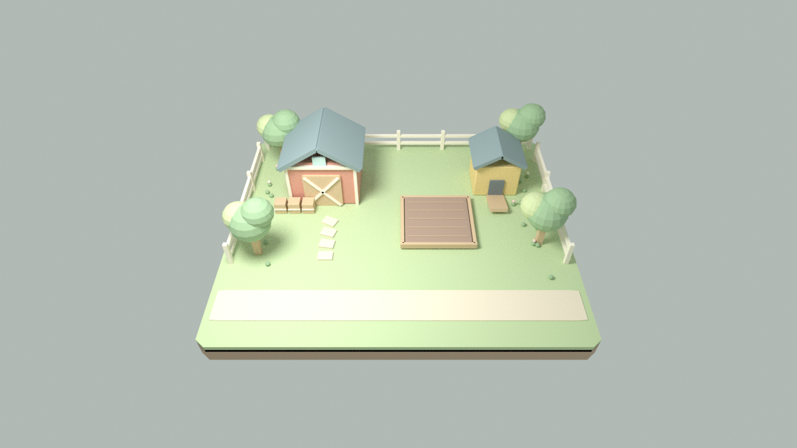

# Meadow: first visual pass

A warm toy farm: cream trim, terracotta barn, sage greens, honey-coloured timber,
muted teal truck and a raised island. Geometry and materials in this change are original
project content built from Unity primitives. No downloaded asset packs, textures,
fonts or third-party models are included. The collection sound is synthesized in code.

## In Unity

Open `Assets/_Project/Scenes/Levels/MVP_Farm.unity`. The barn, coop, trees, fence,
raised garden and market lane are saved scene objects under `Meadow - Art`; they are
visible without entering Play mode. Their materials are in `_Project/Art/Materials`.
The chicken prefab creates its detailed body at runtime, and the truck and growing
crops are created by the scene bootstrap.

Play mode shows a Russian HUD with coins, inventory and chickens at the top,
a contextual garden hint and actions at the bottom, and an expandable market card.
The HUD scales within the device safe area. Clicks and zoom gestures over its panels
are blocked from reaching the farm. Sound can be muted. Economy values are unchanged.

## Review

- Play, plant food, collect an egg, sell five eggs and purchase a chicken.
- Verify market +/-/all/close controls and the return countdown.
- Confirm UI clicks do not plant food or collect eggs behind the panels.
- Check 1280x720, 1920x1080 and a wide mobile landscape aspect with a safe area.
- Check camera zoom, crops, chicken feet/peck animation and truck return.
- Check Console, material import and readability in Unity. A Blender layout render
  is a composition review only; lighting, shader rendering and UI need Unity validation.

`Tools/Art/build_farm_scene.py` reproduces static decoration using a fixed seed and
preserves existing material GUIDs. Re-running replaces the generated art group;
manual edits inside that group should be saved separately first.

The next milestone is review/refinement of this visual direction, not Phase 6.

## Layout preview

This is a Blender render of the persisted scene geometry for composition review,
not a Unity screenshot. Runtime chickens, truck, crops and HUD are not shown.
